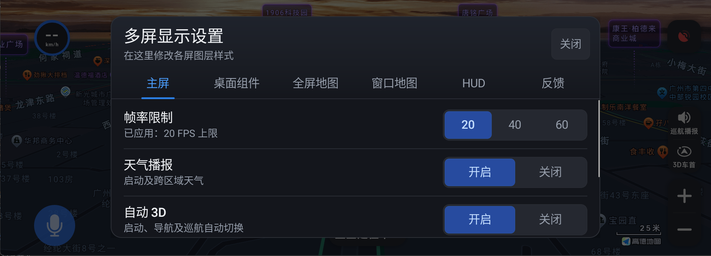
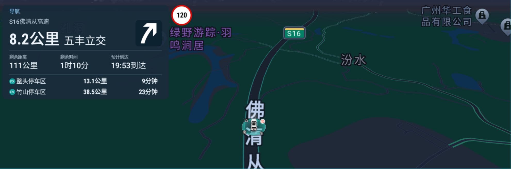
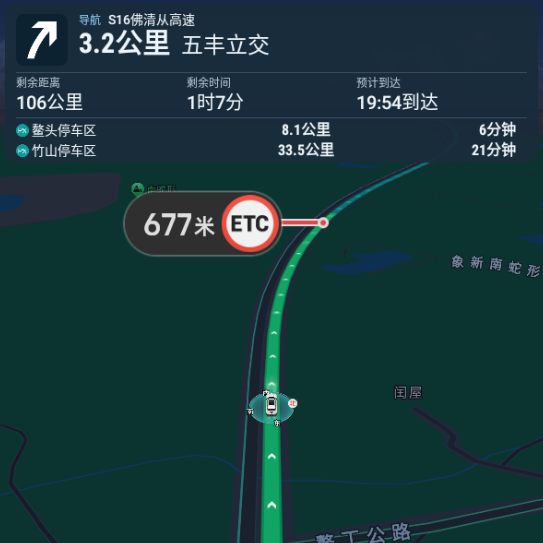
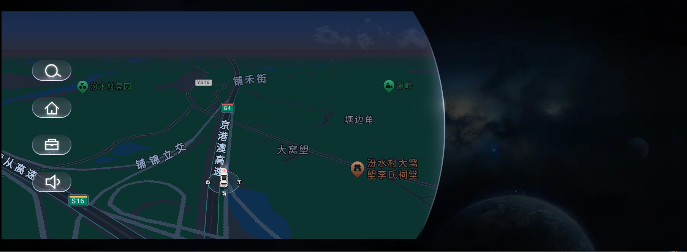

# 高德地图安波福车机定制版多屏功能介绍

基于高德地图车机版 `9.5.0.600013` 魔改。以下功能可以通过**主界面三指长按**弹出配置窗口。

## 主屏

| 功能 | 说明 |
| --- | --- |
| 帧率限制 | 20、30、60 |
| 天气播报 | 启动以及跨区域天气，双槽位去重 |
| 自动 3D | 启动、导航以及巡航自动切换 |
| 光线传感器联动主题 | 安波福车机按光线传感器切换昼夜 |
| 开启组队语音 | 开启原地图隐藏的组队对讲开关。修复安波福车机无法解码 AMR 音频的问题 |
| 丢星续行 | 安波福车机丢星两秒后读取并注入原车辆速度，非安波福实现惯性导航（2026/10/21测试，丢星车速脉冲注入成功，悬浮车速表UI显示仍有问题） |

## 桌面组件、仪表全屏、窗口地图

三屏都有：

| 功能 | 说明 |
| --- | --- |
| 地图视角 | 2D、3D |
| 性能消耗 | 低、中、高。可沿用原性能配置；仅应用当前屏 |
| 地图主题 | 跟随、夜间、白天。跟随沿用主地图昼夜 |
| 字号比例 | 道路与地点文字大小 |
| 气泡比例 | 红绿灯倒计时气泡大小 |
| 车标比例 | 车标与呼吸环大小 |

地图层级：

| 屏幕 | 调整方式 |
| --- | --- |
| 桌面组件 | 滑条调整 |
| 全屏地图 | 方向盘调整，调整后自动保存 |
| 窗口地图 | 方向盘调整，调整后自动保存 |

## 仅仪表全屏与窗口地图

| 功能 | 说明 |
| --- | --- |
| 卡片信息 | 给出导航与道路信息：当前道路、下一地点、本段距离、全程剩余距离、剩余时间和预计到达以及高速服务区信息 |
| 超速泛红 | 自绘泛红呼吸动画，超速时仪表全屏/窗口地图显示 |

## 仅仪表全屏地图

| 功能 | 说明 |
| --- | --- |
| 车道线 | 全屏地图提供 |
| 路口图 | 全屏地图提供 |
| 限速信息组件 | 仅导航模式下生效 |

## HUD

红绿灯 + 车道线显示在 HUD。

| 功能 | 说明 |
| --- | --- |
| 巡航红绿灯开关 | 需要注意巡航模式下出灯率以及受路线不确定性影响，可能缺失或误报。所以增加此开关控制 |
| 红绿灯、车道线 | 可分别设置水平位置、垂直位置、条高度、最大宽度和旋转角度 |

## 其他优化

| 项目 | 说明 |
| --- | --- |
| 悬浮地图 | 新增三指飞屏操作，窗口层级优化。避免地图遮盖语音助理窗口。 |
| 自动3D、红绿灯播报 | 弃用广播方案，采用原地图回调。 |

## 反馈

| 项目 | 说明 |
| --- | --- |
| 日志记录开关 | 储存两天日志。可开启或关闭，默认开启。30次启动后自动关闭 |
| 导出日志 | 问题反馈需要带日志。联系 QQ：446737295，或在 GitHub 提交 Issue |

## 下载

进入 [Release](https://github.com/GroverLau/amap/releases) 页面下载最新版本。

| 文件 | 说明 |
| --- | --- |
| `amap_multiplescreen.apk` | 地图主应用 |
| `mapinstaller.apk` | 地图安装应用（用于安装到系统分区，仅限安波福车机） |

## 部分截图

- 多屏配置窗口

  

- 仪表全屏地图

  

- 仪表窗口地图

  

- 桌面组件

  

## 请我喝咖啡

<table>
  <tr>
    <td align="center"> 微信</td>
    <td align="center"> 支付宝</td>
  </tr>
</table>
